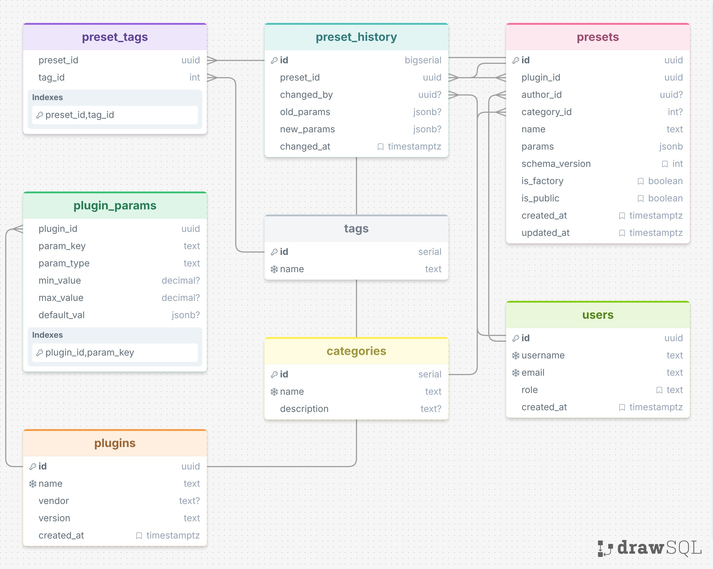

# Preset Plugin — база данных пресетов

C++ приложение для управления пресетами синтезатора с хранением в PostgreSQL.

## Стек

- **C++20** — ядро приложения
- **libpqxx 8.0** — доступ к PostgreSQL
- **nlohmann/json** — сериализация параметров
- **PostgreSQL 18** — хранение
- **CMake 3.20+** — сборка

## Возможности

- CRUD пресетов (создание, чтение, обновление, удаление)
- Поиск по плагину, категории, тегу, имени (нечёткий через pg_trgm)
- JSONB-параметры с GIN-индексом
- Теги через M:N (`preset_tags`)
- Автоматический аудит изменений через триггер `presets_audit`
- Prepared statements — защита от SQL-инъекций
- Строка подключения через переменную окружения

## Структура проекта

```
preset-plugin/
├── CMakeLists.txt
├── README.md
├── sql/
│   └── schema.sql          # схема БД
├── scripts/
│   └── demo.sql            # демонстрационные запросы
└── src/
    ├── main.cpp            # CLI
    ├── preset.hpp          # модель
    ├── preset_repo.hpp     # интерфейс репозитория
    └── preset_repo.cpp     # libpqxx-реализация
```

## Установка зависимостей (Arch Linux)

```bash
sudo pacman -S postgresql postgresql-libs libpqxx nlohmann-json cmake base-devel
```

## Настройка БД

```bash
# Инициализация и запуск
sudo -u postgres initdb -D /var/lib/postgres/data
sudo systemctl start postgresql
sudo systemctl enable postgresql

# Создание пользователя и БД
sudo -u postgres psql -c "CREATE USER matsu WITH PASSWORD '<ваш-пароль>';"
sudo -u postgres psql -c "CREATE DATABASE plugin_db OWNER matsu;"

# Применение схемы
psql "postgresql://matsu:<ваш-пароль>@localhost/plugin_db" -f sql/schema.sql
```

> Если `CREATE EXTENSION` падает с «permission denied», примените `schema.sql` от суперпользователя:
> `sudo -u postgres psql -d plugin_db -f sql/schema.sql`

## Сборка

```bash
mkdir -p build && cd build
cmake ..
make -j8     # замените 8 на число ядер CPU: nproc
```

## Запуск

```bash
# fish
set -x PRESET_DB_URL "postgresql://matsu:<ваш-пароль>@localhost/plugin_db"

# bash / zsh
export PRESET_DB_URL="postgresql://matsu:<ваш-пароль>@localhost/plugin_db"

./preset_cli seed                                 # создать тестовые данные
./preset_cli list MySynth                         # список пресетов
./preset_cli show <uuid>                          # показать пресет
./preset_cli save MySynth "My Bass"               # создать пресет
./preset_cli list MySynth --tag warm --query Pad  # поиск
./preset_cli delete <uuid>                        # удалить
```

## Демонстрация работы триггера аудита

```bash
psql $PRESET_DB_URL -c "UPDATE presets SET params = jsonb_set(params, '{gain}', '0.99') WHERE name = 'Warm Pad';"
psql $PRESET_DB_URL -c "SELECT * FROM preset_history ORDER BY changed_at DESC LIMIT 3;"
```

## Полная демонстрация схемы

```bash
psql $PRESET_DB_URL -f scripts/demo.sql
```

Скрипт `demo.sql` показывает: структуру таблиц, индексы, триггеры, содержимое, M:N-связь, EXPLAIN-план запросов.

## Схема БД

- `users` — пользователи (авторы пресетов)
- `plugins` — виртуальные инструменты
- `categories` — категории (Bass, Pad, Lead...)
- `plugin_params` — метаданные параметров (тип, диапазон)
- `tags` + `preset_tags` — M:N теги
- `presets` — основные пресеты с JSONB-параметрами
- `preset_history` — аудит изменений

Индексы:
- B-tree на FK (`plugin_id`, `author_id`, `category_id`)
- GIN на `params` (jsonb_path_ops)
- GIN на `name` (pg_trgm) для нечёткого поиска
- Partial B-tree на `is_public` для быстрой выборки публичных
- Уникальный индекс `(plugin_id, author_id, lower(name))`

Триггеры:
- `presets_touch` — автообновление `updated_at`
- `presets_audit` — запись в `preset_history` при изменении `params`

## ERD


Кардинальности:
- `presets` N:1 `plugins` (CASCADE)
- `presets` N:1 `users` (SET NULL)
- `presets` N:1 `categories` (SET NULL)
- `presets` M:N `tags` через `preset_tags` (CASCADE)
- `presets` 1:N `preset_history` (CASCADE)
